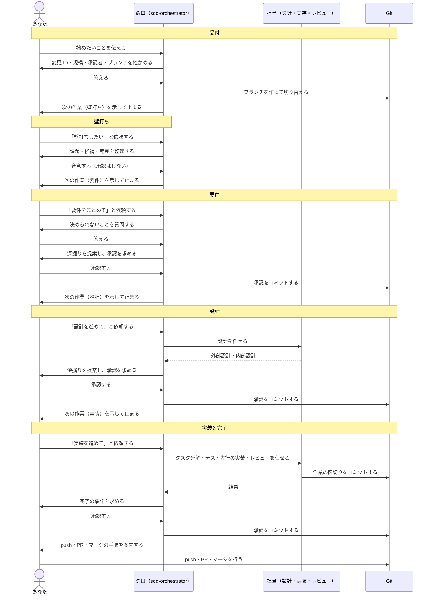

# スペック駆動開発ユーザーガイド

GitHub Copilot / VS Code で、アイデアから実装・検証までを AI と対話しながら進める **利用者** 向けのガイドです。作業の順に説明します。導入は [導入・管理ガイド](https://github.com/miyahiro/ai-powered-spec-drivien-development/blob/main/plugins/sdd/README.md) を参照してください。

## 目次

1. [はじめる前に](#1-はじめる前に)
2. [案件を始める](#2-案件を始める)
3. [判断と承認の答え方](#3-判断と承認の答え方)
4. [工程ごとの進め方](#4-工程ごとの進め方)
5. [途中で行うこと](#5-途中で行うこと)
6. [困ったとき](#6-困ったとき)
7. [付録](#7-付録)

## 1. はじめる前に

### 窓口は sdd-orchestrator

Copilot Chat のエージェント選択で `sdd-orchestrator` を選び、自然言語で依頼します。設計・実装・レビューの担当は、窓口が必要なときに呼びます。エージェントは、作業の前に [共通ルール](common-rules.md) を読みます。

### あなたがすること

- 窓口の質問に答える。
- 工程の区切りで、示された成果物を確かめて承認する。
- ターミナルの実行やファイルの編集の確認ダイアログを許可する（自動承認の設定をしていない場合）。
- push・PR・マージは自分で行う。

コマンドやファイルの書式を覚える必要はありません。

### 規模（標準と軽量）

受付で、案件の規模を選びます。窓口が推奨を示します。

| 規模 | 向いている案件 | 工程 | 承認の回数 |
| --- | --- | --- | --- |
| 軽量 | 数ファイルで済む修正・小さな改善 | 要点 → 実装 → 完了 | 2回（要点・完了） |
| 標準 | 新しい機能、影響の大きい変更 | 壁打ち → 要件 → 設計 → 実装 → 完了 | 3回（要件・設計・完了） |

### どこに何が残るか

| 場所 | 内容 |
| --- | --- |
| `docs/spec/current/` | 全体の仕様（原本）。案件のブランチで直接直される |
| `docs/spec/changes/CHG-0001/status.md` | 案件の状態（工程・質問・承認・次の作業）。開けば今の状況がわかる |
| `docs/spec/changes/CHG-0001/tasks.md` | タスクと確認の結果 |
| `docs/spec/changes/CHG-0001/note.md` | 作業メモ。AI が調べて分かったこと・前提・うまくいかなかったこと・テストの方法を残し、担当や会話が変わっても使う。承認の対象ではない |
| Git のコミット | 承認（`approve(…)`）と作業の区切り |

### 全体の流れ（標準）

あなたが関わるのは、依頼・質問への回答・承認・最後の push だけです。窓口は工程の区切りで次の作業を示して止まるので、次の工程はあなたが依頼して始めます。



軽量では、壁打ち・要件・設計の代わりに「要点」を1回承認します。各工程の詳しい内容は [4. 工程ごとの進め方](#4-工程ごとの進め方) を参照してください。

## 2. 案件を始める

目的・対象・困っていること・制約・対象外を、わかる範囲で伝えます。

```text
問い合わせ一覧の初期表示を、未完了の問い合わせだけにしたいです。
完了済みも必要なときに見られるようにしたいです。承認者は私です。
```

窓口が次を確かめます。

1. 変更 ID（例: `CHG-0001`）、種別、目的、対象と対象外
2. 規模（推奨付き）と承認者
3. ブランチ名（例: `change/CHG-0001`）。「作成してよいですか」に答えると、窓口がブランチを作って切り替えます。

受付が済むと `status.md` ができ、次の作業（標準は壁打ち、軽量は要点）が示されます。

## 3. 判断と承認の答え方

### 質問に答える

質問には、選択肢・推奨・影響・いつまでに決めるかが付きます。確認フォームで選ぶか、文章で答えます。

```text
Q-1 は推奨どおり切り替えボタンにします。
```

窓口が回答の要旨を確かめ、`status.md` と成果物に反映します。後の工程で決める質問は、今の作業を止めません。

### 工程を承認する

工程の成果物がそろうと、窓口が「承認の前に深掘りしますか」と一度だけ聞きます（要件・設計・要点のとき）。深掘りでは AI が判断の抜けを1問ずつ問い、答えが成果物に反映されます。不要なら断ってかまいません。続いて窓口が、工程、対象のファイル、変更の要点を示し、確認フォームで「承認する／修正する」を聞きます。

- 内容がよければ「承認する」を選ぶか、「承認します」と答えます。
- 直したい点があれば「修正する」を選び、直してほしいことを伝えます。

承認すると、窓口が成果物と `status.md` をローカルにコミットし（`approve(要件などの工程): CHG-0001 …`）、次の作業を示して止まります。承認は、次の工程の範囲での編集・テスト・コミットの許可も兼ねます。範囲外の変更、ファイルの削除、新しい依存の追加だけは、その都度聞かれます。

次の答え方は承認になりません。窓口が聞き直します。

- 「続けて」「良さそう」
- 「承認します、ただし〜は直して」のような条件付きの答え
- 登録した承認者以外の人の答え

承認の後に成果物を直した場合は、その工程を承認し直します（状況確認で知らせます）。

## 4. 工程ごとの進め方

窓口は、工程の区切り（受付の後・壁打ちの合意の後・承認の後）で次の作業を示して止まります。次の工程は、あなたが依頼すると始まります。言い方は自由で、「続けて」でもかまいません（「続けて」は承認にはなりませんが、次へ進む依頼にはなります）。

### 軽量: 要点 → 実装 → 完了

1. **要点**: 窓口が、変える要件（原本）を差分で直し、設計の要点（変える箇所・方針・影響・テスト）を `outline.md` に数行で書きます。確かめて承認します。
2. **実装**: 実装担当がタスク一覧（`tasks.md`）を作り、テストを先に書いて実装します。テストのコマンドは確認ダイアログを経て実行され、結果が `tasks.md` に残ります。続いてレビュー担当が、実装と受入条件を照合します。
3. **完了**: すべてのタスクとレビューが済むと、窓口が完了の承認を求めます。承認後、push・PR・マージの手順が案内されるので、自分で行います。

### 標準: 壁打ち → 要件 → 設計 → 実装 → 完了

1. **壁打ち**: 課題・候補・採否・範囲を整理します。合意すると、窓口は次の作業（要件）を示して止まります（ここでは承認しません）。
2. **要件**: 機能ごとの要件・業務ルール・非機能要件・受入条件が原本に書かれます。必要な数値や判断を AI に推測させず、質問に答えてください。確かめて承認します。
3. **設計**: 設計担当が外部設計（画面・帳票・外部連携。不要なら理由を1行）と内部設計（構成・データ・処理・テスト方針）を書きます。後から変えにくい判断は ADR として残すことを勧めます。確かめて承認します。
4. **実装**と**完了**: 軽量と同じです。

依頼の例:

```text
要件を整理してください。決められないことは質問してください。
```

```text
承認した要件から設計を進めてください。
```

```text
タスクを分けて、テスト先行で実装を進めてください。
```

## 5. 途中で行うこと

| したいこと | 依頼の例 | 窓口が行うこと |
| --- | --- | --- |
| 検査する | 「検査して」 | 仕様と案件の形式を検査し、エラーと警告を示す（ファイルは変えない） |
| 状況を知る | 「CHG-0001 の状況を教えて」 | 検査スクリプトの要約と `status.md` だけで、工程・状態・期限の来た質問・承認と再承認が必要な工程・タスク・次の作業を示す。ファイルは変えない |
| 記録を見る | 「CHG-0001 の記録を見せて」 | 承認と質問の表、承認のコミットの一覧を示す |
| 止める | 「止めて」 | 中断を `status.md` に書き、次に再開する地点を示す |
| 再開する | 「CHG-0001 を続きから再開して」 | ブランチ・再承認・期限の来た質問を確かめてから続ける |
| 前の工程に戻す | 「要件に戻して」 | 確かめてから工程を戻す。戻した工程から承認し直す |
| 深掘りしてもらう | 「この要件を grill-me して」 | 判断の抜けを1問ずつ推奨付きで聞き、答えを `status.md` と成果物に反映する。「ここまで」で止まる |
| 影響を調べる | 「この変更の影響を調べて」 | 影響する仕様・コード・回帰テスト・承認し直す工程を示す（ファイルは変えない） |
| レビューしてほしい | 「この設計書をレビューして」 | 指摘だけを返す（ファイルは変えない） |

新しい会話でも、変更 ID を伝えれば `status.md` と Git の履歴から再開できます。`status.md` は自分で編集してもかまいません。

## 6. 困ったとき

| 状況 | 行うこと |
| --- | --- |
| 承認されない | 対象が示された後に「承認する」または「承認します」と答えたか、承認者として登録した人か、期限の来た質問が残っていないかを確かめる |
| 「再承認が必要」と表示される | 承認の後に対象のファイルが変わっている。内容を確かめて、もう一度承認する |
| 検査でエラーが出る | 表示されたファイルと行を窓口に伝え、直してもらう |
| ブランチを切り替えられない | 未コミットの変更がある。窓口が示す選択肢（コミットする、退避する、そのまま続ける）から選ぶ |
| push してほしい | AI は行いません。案内された手順で自分で行う |
| エージェントやスキルが見つからない | プラグイン `sdd` がインストールされて有効か（リポジトリ版なら `.github/agents/`・`.github/skills/` があるか）、Workspace Trust を、導入した人に確認してもらう |
| 古い手順で動いているようだ | workspace の `.github/agents/`・`.github/skills/` にあるエージェント・スキル（リポジトリ版を含む）は、同じ名前のプラグインより優先される。リポジトリ版の版が古くないかを、導入した人に確認してもらう |

## 7. 付録

### エージェント

| エージェント | 担当 |
| --- | --- |
| [sdd-orchestrator](../agents/sdd-orchestrator.agent.md) | 窓口。受付・壁打ち・要件・質問・承認とコミット・状況確認 |
| [sdd-designer](../agents/sdd-designer.agent.md) | 外部設計・内部設計・ADR |
| [sdd-implementer](../agents/sdd-implementer.agent.md) | タスク分解・テスト先行の実装 |
| [sdd-reviewer](../agents/sdd-reviewer.agent.md) | 読み取り専用のレビュー |

### スキル（直接指定もできます）

| 直接指定 | 使う場面 |
| --- | --- |
| [/sdd-change-intake](../skills/sdd-change-intake/SKILL.md) | 受付 |
| [/sdd-workflow-status](../skills/sdd-workflow-status/SKILL.md) | 状況確認・記録の一覧・再開 |
| [/sdd-clarification](../skills/sdd-clarification/SKILL.md) | 質問と回答 |
| [/sdd-grill-me](../skills/sdd-grill-me/SKILL.md) | 承認の前の深掘り |
| [/sdd-phase-approval](../skills/sdd-phase-approval/SKILL.md) | 承認とコミット |
| [/sdd-idea-dialogue](../skills/sdd-idea-dialogue/SKILL.md) | 壁打ち |
| [/sdd-requirements-definition](../skills/sdd-requirements-definition/SKILL.md) | 要件・軽量の要点 |
| [/sdd-external-design](../skills/sdd-external-design/SKILL.md) | 外部設計 |
| [/sdd-ddd-internal-design](../skills/sdd-ddd-internal-design/SKILL.md) | 内部設計・ADR |
| [/sdd-change-impact-analysis](../skills/sdd-change-impact-analysis/SKILL.md) | 変更の影響の調査 |
| [/sdd-task-planning](../skills/sdd-task-planning/SKILL.md) | タスク分解 |
| [/sdd-tdd-cycle](../skills/sdd-tdd-cycle/SKILL.md) | テスト先行の実装 |
| [/sdd-review](../skills/sdd-review/SKILL.md) | レビュー |
| [/sdd-spec-check](../skills/sdd-spec-check/SKILL.md) | 仕様と案件の検査・状況の要約 |

壁打ち・質問整理・深掘り・状況確認・検査・レビューは、承認がなくても使えます。スキルを直接指定したときは共通ルールが読まれず、そのスキルの手順に書いた範囲だけが守られます。普段は `sdd-orchestrator` から使ってください。
