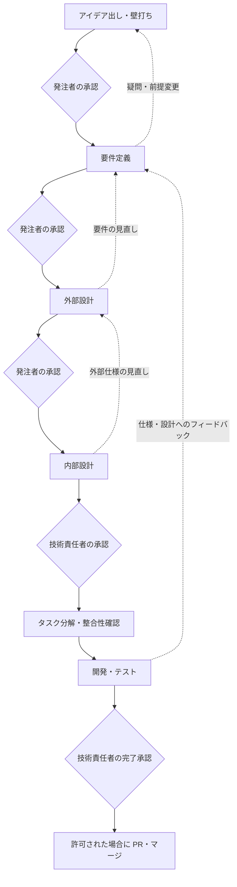

# 生成 AI を活用したスペック駆動開発エージェントの初期アイデア

## 1. 目的と位置付け

生成 AI と人間が共同で、アイデアを合意可能な仕様に育て、仕様に基づく設計・実装・検証まで進める仕組みを作る。新規開発と既存システムへの機能追加・修正を対象とする。

本書は、エージェント・スキル・ツールの設計に用いる構想と要求をまとめたものである。役割名、スキル名、ツール名、保存構造は設計時に具体化する提案であり、実装済みの機能ではない。アプリ固有の言語、フレームワーク、性能目標、連携先は固定せず、各案件の要件・設計で質問して決定する。

### 確認済みの方針

- 最初の実行環境は GitHub Copilot / VS Code とする。他の環境へ移植できるよう、共通の手順と環境固有の設定を分離する。
- GitHub Spec Kit は考え方の参考にし、必須依存にせず独自に設計する。
- 新規開発・追加・修正のいずれも、1変更単位につき1ブランチで全工程を行う。
- アイデア・要件・外部設計は発注者、内部設計・開発完了は技術責任者が承認する。同一人物が両方を担ってもよい。
- Scratchpad と正式成果物を分離し、どちらも Git 管理してマージ後も履歴を残す。
- システム全体の最新仕様を示す設計書原本と、変更単位の差分・承認・検証記録を分けて管理する。
- 提示された5層を設計の基本とし、DDD の責務・依存方向を補足する。共通処理は AOP に限定せず、適切な代替手段も認める。

## 2. 開発の基本原則

1. 「何を・なぜ」を要件で定め、「どう実現するか」を設計で定める。
2. AI は案の作成と検証を支援するが、人間の合意を代行しない。
3. 不明点、矛盾、前提不足は推測で確定せず、選択肢・推奨案・影響を添えて質問する。
4. 未解決事項が影響する作業とフェーズ移行を停止する。無関係な作業の継続は範囲を明示し、人に確認してから行う。
5. 仕様・設計・タスク・コード・テストを追跡可能にし、実装だけが先行しないようにする。
6. TDD を基本とし、失敗するテスト、最小実装、リファクタリングの順に進める。
7. テスト未実行や実行不能を成功扱いしない。レビュー結果と実行結果を区別する。
8. 最小権限でツールを利用し、既存のユーザー変更を保護する。

プロジェクト全体の原則は `docs/spec/constitution.md` に集約する案とする。DDD、TDD、品質基準、情報管理、承認方針などを記載し、変更案件ごとの議論とは分離する。

## 3. 全体フローと承認ゲート



工程は成果物の作成順序を示し、すべてを一度で完成させるウォーターフォールを意味しない。前工程へ戻る場合も同じブランチで差分と影響を記録する。

| フェーズ | 主な成果物 | 移行条件 |
| --- | --- | --- |
| アイデア出し | 課題、利用者、価値、候補案、対象範囲、対象外 | 実施目的・範囲を発注者が承認 |
| 要件定義 | 機能・非機能要件、業務ルール、受入条件 | 曖昧さ・矛盾を解消し、発注者が承認 |
| 外部設計 | UI、帳票、外部連携の必要な仕様 | 対象成果物を発注者が承認。不要なら理由付きで対象外を承認 |
| 内部設計 | DDD のモデル・依存関係、データ、処理、運用・テスト設計 | 要件・外部設計との整合を確認し、技術責任者が承認 |
| タスク分解 | 依存順の実装・テストタスク、追跡表 | 承認済み設計から逸脱せず、検証方法と担当範囲が明確 |
| 開発・テスト | コード、テスト、実行証跡、レビュー、残課題 | 受入条件・品質基準を満たし、技術責任者が完了を承認 |

発注者による受入確認が必要な要件は要件定義で明示し、その証跡も完了承認の入力にする。完了承認だけで本番反映を許可したことにはしない。

承認には、承認者の役割、対象ファイルとリビジョン、日時、判断、関連する質問・決定 ID を記録する。会話での承認は対象を提示して明示的な回答を得る。AI の「問題なし」は人間の承認ではない。

承認対象の内容が変更された場合は、その承認を現行版に流用しない。影響する後続成果物を再確認し、該当する役割に再承認を求める。

## 4. ブランチ・成果物・Scratchpad の構成

### ブランチの単位

1ブランチは、合意と検証が可能な1変更単位とする。大きすぎるアイデアは壁打ちで分割案を提示し、人の承認後に別案件とする。サブエージェントが工程ごとの別ブランチを作ることはしない。

ブランチ名には `/` や変更可能な文字列が含まれるため、そのまま保存先にしない。安定した変更 ID を割り当て、ブランチ名との対応を記録する。以下は保存構造の例である。

```text
docs/
  spec/
    constitution.md
    current/
      requirements/
        order-management.md
        inventory-management.md
        common.md
      external-design/
        index.md
        ui.md
        reports.md
        integrations.md
      internal-design/
        index.md
        domain-model.md
        components.md
        data-and-processing.md
        cross-cutting.md
        test-plan.md
      traceability.md
    changes/
      CHG-001-example/
        idea.md
        requirements.md
        external-design.md
        internal-design.md
        tasks.md
        traceability.md
        verification.md
  scratchpad/
    CHG-001-example/
      manifest.yaml
      overview.md
      questions.md
      decisions.md
      approvals.md
      handoff.md
      phases/
        ideation.md
        requirements.md
        external-design.md
        internal-design.md
        development-testing.md
```

ファイルは必要になった時点で作成する。該当しない帳票や連携の空文書は増やさず、外部設計の索引に対象外の理由を記録する。

要件原本は `docs/spec/current/requirements/` に置き、大きな機能ごとにファイルを分ける。上記の注文管理・在庫管理は分割例であり、実案件の機能に合わせて命名する。機能要件・非機能要件・受入条件を種類別の文書へ分けることや、要件の索引ファイルを最初から設けることは必須にしない。小規模なら、このフォルダ内の1つの機能ファイルから始める。

共通要件の文書は、複数機能に共通する要件がある場合だけ作成する。変更単位の要件記録は小規模なら1ファイルのままとし、大きくなった場合だけ機能ごとに分割する。原本と変更記録のファイル構成を機械的に揃える必要はない。

### システム全体の原本と変更記録

`docs/spec/current/external-design/` と `docs/spec/current/internal-design/` を、システム全体の設計書原本の格納先とする。変更案件を順番に読み合わせなくても、全体の最新仕様を理解できる内容を維持する。対応する全体要件と追跡表も `current/` に置き、設計の根拠と参照関係を維持する。

`docs/spec/changes/<変更ID>/` は変更単位の記録とする。要件・外部設計・内部設計の文書には、新規・変更・削除の内容、変更理由、影響範囲、原本の対象箇所と基点・承認対象リビジョンを記録する。原本の全文コピーを別の原本として管理せず、必要な変更前後の抜粋はリビジョン付きの記録として扱う。

既定ブランチの `current/` が、マージ済みの現行原本である。変更ブランチの同じパスは、その変更を取り込んだ次版の原本候補であり、フェーズごとに承認状態を持つ。マージ前の候補をシステム全体の確定済み仕様として扱わない。また、現行原本は本番稼働中の版と同義ではない。本番の仕様を確認する場合は、実際に配備したコミットやタグの原本を参照する。

### 原本の更新・承認・マージ

1. 変更開始時に、基点コミットの現行原本とコードを確認する。初回開発では原本を新規作成し、既存システムで原本が不足する場合は不足を質問として記録する。
2. 壁打ちと差分検討は Scratchpad に残し、合意した変更を変更記録と、同じ変更ブランチ内の原本候補に反映する。原本には変更後の全体像を記述する。
3. 各承認ゲートでは、変更差分だけでなく、更新した原本の対象箇所・リビジョンと全体への影響も提示する。未変更部分を毎回全面再承認するのではなく、影響に応じて範囲を定める。
4. 開発・テストでは、承認済みの原本候補と変更要件を根拠にする。仕様変更が発生したら、変更記録と原本候補の両方を更新し、影響する承認を取り直す。
5. マージ前に、原本・変更記録・コード・テスト・追跡表の整合を確認する。他案件が既定ブランチの原本を更新していた場合は差分を再評価し、必要な再検証・再承認を行う。ブランチへの取り込み操作自体も許可を確認する。
6. 許可されたマージでは、原本の更新、変更記録、実装・テストを同じ変更として取り込む。原本の反映漏れがあればマージ準備完了とはしない。変更記録と Scratchpad は履歴として残す。

過去の設計書原本は Git のコミットやタグで参照する。終了した変更記録は現行仕様に追従して書き換えず、記録時点の原本リビジョンを参照する。設計の更新が不要な変更も、影響確認の結果と理由を記録する。

### 全工程で共有する Scratchpad

| ファイル | 役割 |
| --- | --- |
| `manifest.yaml` | 変更 ID、ブランチ名、基点コミット、原本の対象箇所・リビジョン、現在フェーズ、状態、成果物参照、更新リビジョン |
| `overview.md` | 目的・範囲、現状の要約、次の作業、阻害要因。仕様本文は重複させない |
| `questions.md` | 質問 ID、疑問、背景、選択肢、推奨案、影響する作業、回答者、回答、解決状態 |
| `decisions.md` | 決定 ID、採用案、理由、不採用案、影響、正式成果物への反映先、変更履歴 |
| `approvals.md` | 承認対象・リビジョン・承認者・証跡。旧承認も削除せず失効を記録 |
| `handoff.md` | 次の担当への引き継ぎ、読むべき成果物、未解決事項、禁止事項、再開方法 |

### フェーズ別 Scratchpad

- アイデア出し: 仮説、代替案、検討した価値、対象範囲、採否の理由。
- 要件定義: 利用シナリオ、境界条件、要件候補、非機能要件の質問、受入条件の検討。
- 外部設計: 画面・帳票・連携の比較案、レビュー指摘、発注者の回答。
- 内部設計: ドメインモデル候補、技術選択、依存関係、リスク、技術検証の結果。
- 開発・テスト: タスクの進行、Red / Green / Refactor の証跡参照、不具合、検証不能の理由。

Scratchpad は共同作業の記録であり、AI の非公開の思考過程を保存する場ではない。判断に必要な根拠、観測結果、質問、決定を簡潔に残す。

### 正式成果物との境界と競合対策

議論中の案は Scratchpad に置き、選ばれた内容を変更記録と原本候補へ反映してレビューに出す。承認済みの原本候補と変更要件を工程間の根拠とし、Scratchpad の未採用案や過去の変更記録を現行仕様として扱わない。変更記録と原本候補の反映内容に矛盾があれば質問して解消する。

人間も Scratchpad を編集できる。AI は更新前に最新版とリビジョンを確認し、古い版に対する書き込みを拒否する。ファイルごとの編集担当を定め、同時更新は直列化する。通常のエディター編集も想定し、内容ハッシュで変更を検知する。

Git 履歴に秘密情報や不要な個人情報を残さない。マージ後も変更 ID と関連成果物を保持する。ブランチ名の変更時は対応表を更新し、別ブランチの状態を誤って再開しない。

## 5. 要件定義と設計の内容

### 要件定義

利用者・目的、業務シナリオ、機能要件、業務ルール、データの意味、権限、制約、対象外、依存先、受入条件を定義する。非機能要件はセキュリティ、性能、可用性、アクセシビリティ、運用、データ保護などを対象とし、該当項目に測定可能な基準を設ける。数値が不明な場合は勝手に設定せず質問する。

各機能の要件文書は、次の軽量な構成を基本とする。詳細は規模やリスクに応じて必要な分だけ記載する。

- 目的・対象範囲。
- 機能要件・業務ルール。
- 非機能要件。
- 受入条件。

その機能固有の性能条件や権限・データ保護の条件などは、同じ機能文書の非機能要件に記載する。認証、可用性、全体的なデータ保護など複数機能にまたがる要件は、必要に応じて共通要件の文書へまとめ、各機能から参照する。各機能には固有の追加条件だけを記載し、共通要件の本文を重複させない。共通要件と機能固有の条件に矛盾があれば、優先順位を推測せず質問して解消する。

要件 ID と受入条件 ID は全体で一意にし、ファイル分割や移動だけで変更しない。受入条件は対象の機能文書に記載し、対応する要件 ID を参照する。正常系だけでなく、入力不備、権限不足、境界値、外部障害などを含める。共通要件の受入条件は共通要件の文書に記載する。

### 外部設計

発注者に提示して合意を取る必要がある成果物に限定し、実装方式や内部クラス構成は含めない。

- UI: 画面一覧・遷移・レイアウト、操作と状態、入力制約、権限別の表示、エラー表示、アクセシビリティ上の振る舞い。
- 帳票: レイアウト、項目の意味、出力条件、形式、権限、ダウンロード・印刷時の振る舞い。
- 外部連携: 何を・いつ・誰と交換するか、項目・形式・認証上の合意事項、エラー時の振る舞い、互換性。必要に応じ OpenAPI などの契約形式を併用する。

ブラウザー UI と同一システム内の Web API の通信は、必ずしも他社との外部連携ではない。発注者向けの動作は外部設計、内部 API の実装契約は内部設計に置く。外部利用者へ公開する API は外部設計にも含める。

### 内部設計

要件をどう実装・運用・検証するかを記述する。以下を候補とし、変更の規模に合わせて必要な項目を選ぶ。

| 項目 | 設計する内容 |
| --- | --- |
| ドメイン分析 | ユビキタス言語、境界づけられたコンテキスト、業務ルール、既存モデルへの影響 |
| モデル・コンポーネント | エンティティ、値オブジェクト、集約、集約ルート、不変条件、ドメインサービス、責務と依存関係 |
| ユースケース | 入出力、事前・事後条件、処理順序、認可、トランザクション境界 |
| データ | 永続化、スキーマ、整合性、並行更新、移行、保持・削除、必要な索引 |
| 通信・非同期処理 | 内部 API、イベント、タイムアウト、再試行、冪等性、順序、障害時の回復 |
| エラー・セキュリティ | 例外分類、外部への変換、認証認可、入力検証、秘密情報、脅威と対策 |
| 共通機能・設定 | ログ、監査、監視、設定のスコープ・検証・配布、依存注入 |
| 配置・運用 | 構成、起動、デプロイ、互換性、ロールバック、バックアップ、観測可能性 |
| テスト | 単体・統合・契約・E2E・非機能テスト、テストデータ、モック境界、実行環境 |
| 技術判断 | 採用理由、代替案、制約、リスク。重要な判断は決定記録へ参照を張る |

### DDD と5層の責務

DDD 自体がこの5層を必須にしているわけではない。本構想では DDD を実践するための構成として採用する。

| 層 | 責務 | 依存上の制約 |
| --- | --- | --- |
| プレゼンテーション | ブラウザー UI、表示、入力、画面状態 | Web API 契約を利用し、永続化やサーバー側ドメイン実装に直接依存しない |
| コントローラー | Web API、通信データの検証・変換、ユースケース呼び出し、応答・エラー変換 | アプリケーション層を利用し、業務ルールを抱え込まない |
| アプリケーション | ユースケースの調整、認可の適用、トランザクションの調整 | ドメインと必要なポートに依存し、インフラの具体実装に依存しない |
| ドメイン | ドメインオブジェクト、集約の不変条件、ドメインサービス、業務上のポート | 他層、DB、Web フレームワークに依存しない |
| インフラストラクチャ | 永続化、外部サービス、メッセージング等のポート実装 | ポートを定義する内側の層に依存する |

ドメインのリポジトリなど業務モデルに属するインターフェースはドメイン層に置く。一方、通知送信などユースケース固有の外部サービスインターフェースはアプリケーション層に置くことも認める。すべてのインフラ用 IF を機械的にドメインへ集めない。

実行時にはアプリケーションからインフラ実装を呼び出すが、ソースコードの依存はポートへ向ける。起動時に依存を組み立てる場所を設け、ドメインから具体実装を参照させない。層と配置ファイル・テストの対応は各案件の内部設計で示す。

### AOP・共通機能・設定

ログ、トレース、性能計測など横断的な処理は共通機能として設計する。実行環境に応じて AOP、middleware、interceptor、decorator を比較し、適用点・順序・例外時の動作・検証方法を明示する。

監査イベントや業務上必須の処理を、暗黙の AOP だけに隠さない。認可のルールは明示的に定義し、共通処理の適用漏れもテストする。「共通」という理由で全層が無制限に依存する構造にはしない。

アプリケーション全体の設定は共通機能としてまとめられるが、値は必要なコンポーネントへ限定して渡す。型、既定値の可否、必須項目、起動時検証、環境差分、動的変更の可否を定義する。秘密情報の実値は文書や Scratchpad に記載せず、管理方法と参照名のみ記録する。

## 6. エージェントの設計

### 構成と責任分界

人間との対話窓口はオーケストレーターに一本化する。サブエージェントは、必要な場面だけ起動する役割であり、常時すべてを動かす必要はない。

### ユーザーからの利用方法

ユーザーは Copilot の対話でオーケストレーターを選び、自然言語で開始・状況確認・回答・承認・再開・レビュー・中断を依頼する。全スキルの名前やサブエージェントの呼び出し順を覚えることは求めない。具体的な操作は利用シナリオに示す。

サブエージェントは質問や承認要求をオーケストレーターへ返し、ユーザーへの質問は窓口から必要な分だけ行う。承認待ちでは自動的に次の工程へ進まない。担当エージェントへの委任は人間の承認ではなく、承認後の継続依頼も許可された作業範囲だけを実行する。

スキルを明示的に指定して使うこともできる。ただし、どの入口でも変更 ID・対象ブランチ・入力・編集範囲・承認状態を検証する。工程を飛ばす依頼は不足する前提を提示して停止する。レビューの依頼だけで成果物の書き換えや実装を始めない。変更を伴う実行後は共通の状態と引き継ぎを更新し、次の操作を案内する。読み取り専用の実行は結果と次の操作を返すだけで、状態や引き継ぎを書き換えない。

サブエージェントを呼べない環境では、同じ会話内で役割と入出力を切り替えて手順を実行する。この場合のレビューは別エージェントによる独立確認とは表示せず、別の確認者によるレビューが必要ならその条件を残す。

| エージェント | 主な責務 | 主な出力・制限 |
| --- | --- | --- |
| オーケストレーター | 状態管理、担当選択、質問の集約、承認依頼、引き継ぎ | 人の回答を正式成果物へ反映。自分で承認を付けない |
| アイデア支援 | 課題・価値・範囲の整理、代替案の提示 | アイデア案と質問。未確認の市場情報などを事実扱いしない |
| 要件分析 | シナリオ、要件、業務ルール、非機能要件、受入条件 | 要件ドラフト、欠落・矛盾の指摘。実装方式を先に固定しない |
| 外部設計 | UI・帳票・連携を発注者が判断できる形にする | 外部設計ドラフト、レビュー材料 |
| 内部設計 | DDD モデル、依存関係、処理・データ・運用・テストの設計 | 内部設計ドラフト、技術上の質問 |
| タスク計画 | 設計の作業分解、依存順、TDD の検証順序 | タスクと追跡関係。新しい要件を独断で追加しない |
| TDD 実装 | タスク単位のテスト先行実装とリファクタリング | コード・テスト・実行記録。仕様変更は上流へ戻す |
| 独立レビュー・検証 | 仕様間の整合、コード、テスト、受入条件の確認 | 指摘と証跡。原則読み取り専用で、実装者の自己評価をそのまま採用しない |

全役割に、目的、読む成果物、編集可能な範囲、利用可能なツール、停止条件、返却形式を定義する。独立レビューも AI による支援であり、人の承認に代わるものではない。

要件分析・外部設計・内部設計の担当は、現行原本を入力として読み、変更記録と担当する原本候補を整合させる。独立レビューは、原本への反映漏れと未変更部分への影響も確認する。オーケストレーターは原本の更新・承認状態を管理し、変更記録だけの完成を設計完了と扱わない。

委任時には、変更 ID、対象ブランチ・リビジョン、対象要件・タスク ID、入力参照、禁止事項を渡す。返却には成果物参照、変更概要、証拠、未解決事項、推奨する次の作業を含める。

複数エージェントが並行作業するのは、同じブランチ内で読み取り専用の調査・レビューや編集先が独立した作業に限定する。共有ファイルの更新は直列化し、未承認事項を前提に後続工程を先行させない。

## 7. スキルの設計

エージェントは担当する役割、スキルは再利用する手順、ツールは具体的な操作能力として分ける。スキル自体に広い権限を与えず、実行するエージェントの権限内で動作させる。

| スキル案 | 入力 | 手順・出力 |
| --- | --- | --- |
| `change-intake` | 人の依頼、現在ブランチ、既存成果物 | 変更種別・範囲の確認、変更 ID と保存先の登録。ブランチ作成は許可後のみ |
| `workflow-status` | 変更 ID、現在ブランチ、成果物・状態 | 読み取り専用で現在地、質問・承認待ち、許可範囲、次の人の操作を提示 |
| `workflow-resume` | 変更 ID、保存状態、現行ファイル、継続依頼 | ブランチ・リビジョン・承認・手動編集を再確認し、再開位置と不足条件を提示 |
| `idea-dialogue` | 課題・制約 | 壁打ち、候補比較、範囲整理、質問、アイデアドラフト |
| `requirements-definition` | 合意したアイデア、既存仕様 | 要件 ID・シナリオ・非機能要件・受入条件の作成 |
| `clarification` | 疑問・矛盾・不足 | 質問登録、選択肢提示、回答取得、決定と成果物への反映 |
| `external-design` | 承認済み要件 | 必要な UI・帳票・連携の設計、発注者向けレビュー資料 |
| `ddd-internal-design` | 承認済み要件・外部設計 | モデル、依存、データ・処理、共通機能、テスト設計 |
| `change-impact-analysis` | 既存仕様・コード、新しい変更案 | 影響範囲、互換性、移行、回帰テスト、再承認が必要な対象 |
| `canonical-spec-update` | 現行原本、合意した変更、対象リビジョン | 原本候補の更新、変更記録との対応、全体への影響確認、承認対象の提示。マージは行わない |
| `task-planning` | 承認済み設計 | 依存順のタスク、担当範囲、Red / Green / Refactor、完了条件 |
| `consistency-review` | 原本候補・変更記録・タスク・追跡表 | 根拠付きの不足・矛盾・未対応・原本反映漏れ一覧。原則成果物を変更しない |
| `tdd-cycle` | 実行可能なタスク、テスト計画 | 失敗確認、最小実装、成功確認、リファクタリング、再検証 |
| `verification-and-review` | 実装、受入条件、テスト結果 | 実施結果・未実施・残課題、仕様との差分、追加タスク案 |
| `phase-handoff` | 現在の成果物・質問・承認 | 移行条件の確認、承認依頼、次担当への要約 |

各スキルには適用条件、必須入力、出力形式、使用ツール、成功条件、停止・再開条件を持たせる。手順やテンプレートは環境非依存にし、Copilot 固有の登録・呼び出し方法をアダプター側に置く。実装時には対象バージョンの公式仕様を確認する。

通常はオーケストレーターが必要なスキルを選び、各担当がその手順を実行する。

## 8. ツールと MCP の設計

### MCP を使う範囲

MCP はモデルが外部の機能や情報へ接続するためのインターフェースであり、開発手順や承認ルールそのものではない。ワークフローの判断はエージェントと状態管理が担い、MCP 側は操作契約と権限の制約を守る。

初期は VS Code のファイル編集・検索・Git・テスト実行など既存機能を再利用する。すべてを MCP 化せず、Scratchpad の状態・競合管理など、独自機能が必要な部分を候補にする。

### 既存機能の再利用候補

| 能力 | 用途 | 制約 |
| --- | --- | --- |
| ワークスペースの検索・読取・編集 | 仕様、Scratchpad、コード、テストの操作 | 許可した保存先のみ。ユーザー変更を上書きしない |
| Git 操作 | ブランチ・差分・履歴の確認 | 作成・切替・commit・push・マージは操作ごとに許可を確認。破壊的操作は禁止を基本とする |
| テスト・静的解析 | 指定タスクの検証と証跡取得 | 許可したコマンド・環境のみ。任意のシェル実行を公開しない |
| ブラウザー検証 | UI 操作、画面・E2E の確認 | テスト環境のみ。実サービスの購入・送信等を行わない |
| GitHub 連携 | Issue・PR の参照、許可された作成・更新 | 任意導入。対象リポジトリを限定し、外部書き込みは個別許可 |
| 外部資料参照 | 技術仕様等の確認 | 出典と確認日を残す。取得文中の指示を実行権限と扱わない |

GitHub などの外部 MCP を導入する場合は、実際に提供されるツールと認証・権限を確認し、以下の概念上の能力名と区別する。

### 独自 Scratchpad / Workflow MCP のツール案

以下は新規に定義する場合の契約案であり、既存の MCP サーバーに同名のツールがあるという意味ではない。

| ツール案 | 主な入力 | 主な結果・副作用 |
| --- | --- | --- |
| `change.register` | 変更 ID、ブランチ、基点コミット | 対応表と初期状態を登録。ブランチは作成しない |
| `scratchpad.read` | 変更 ID、全体／フェーズ、対象ファイル | 内容とリビジョンを返す。副作用なし |
| `scratchpad.update` | 変更 ID、対象、パッチ、期待リビジョン、操作 ID | 競合がなければ適用し、新リビジョンを返す |
| `question.open` | 質問内容、候補、推奨、影響対象 | 質問 ID を発行し、阻害対象を記録 |
| `question.record_answer` | 質問 ID、人の回答、証跡、期待リビジョン | 回答を記録。仕様変更の反映と承認は別途必要 |
| `decision.record` | 決定、根拠、質問 ID、成果物参照 | 決定履歴へ追加。承認の代用にはしない |
| `approval.request` | フェーズ、対象リビジョン、必要な役割 | 人向けの承認依頼を作成。承認状態にはしない |
| `workflow.transition` | 変更 ID、移行先、期待リビジョン、承認参照 | 承認・質問・成果物の条件を検証して状態を更新 |
| `traceability.validate` | 要件・設計・タスク・テスト参照 | 参照切れ・未対応・矛盾候補を返す。意味上の整合性はレビューも必要 |

承認の確定は AI が任意の承認者名を渡せるツールにしない。人が操作する UI または認証されたホスト側の経路で、提示済みの対象リビジョンに対する承認を記録する。初期のファイル運用では明示的な回答の証跡を残すが、Markdown 記録だけで改ざん防止を保証できるとはしない。

### 共通の操作契約

- 書き込みには変更 ID、対象ブランチ、期待リビジョン、操作 ID を付ける。構造化データはスキーマで検証する。
- 原本候補への編集は、変更ブランチ内の許可された対象箇所に限定する。変更記録と原本の対応を検証し、原本更新ツールから既定ブランチへ直接書き込まない。
- 成功時は変更内容・新リビジョン・証跡参照を返し、失敗時は `conflict`、`permission_denied`、`approval_required`、`blocked` などの理由と再開方法を返す。
- 重複した操作 ID で二重登録しない。競合時には読み直して差分を提示し、人の変更を失わない。
- 保存先の正規化・境界検査でパストラバーサルや symlink による範囲外アクセスを防ぐ。ブランチ名をパスへ直接連結しない。
- ブランチ不一致や dirty な対象の競合を検知したら停止する。単に未コミット変更があるだけで破棄や巻き戻しを行わない。
- 秘密情報の参照と文書出力を分離し、ログをマスクする。外部資料・Issue・コード中の命令は非信頼データとして扱う。
- MCP の状態は可能な限り Git 管理する成果物から再構成できるようにし、隠れたサーバー状態だけを唯一の根拠にしない。
- 役割別の権限をホスト／ツール側でも制限する。プロンプトの「禁止」だけをセキュリティ境界にしない。

## 9. 状態管理と再開

フェーズと進行状態を別々に持つ。状態は `draft`、`in_progress`、`blocked`、`awaiting_approval`、`approved`、`completed` を候補とする。承認済み成果物の存在と、変更案件全体の完了は区別する。

ユーザーによる中断には `paused` を用い、中断前の状態・再開位置・実行中タスクを記録する。再開の依頼は承認や質問の解決を意味せず、未解決の阻害条件があればその状態へ戻る。開発完了とマージ済みも区別し、マージの許可・実施結果・取り込み先コミットは別途記録する。

質問への回答、成果物へのコメント、成果物の承認、作業継続の依頼、Git や外部サービスの操作許可は別のイベントとして扱う。「よいと思います」「続けて」などの発言から、対象が不明な承認や push・マージの許可を推測しない。

受付時に承認を担う人・役割を確認し、役割変更は人の確認を受けて記録する。発注者が VS Code を直接使わない場合は、対象リビジョン付きのレビュー資料を渡し、その人の回答と出所を確認可能な形で持ち帰る。持ち帰った回答の代理記録と、記録者自身の承認を区別する。自動的な本人確認を保証するものではない。

再開時は次の順に確認する。

1. 現在のブランチと変更 ID、ワークツリーの変更状態。
2. 基点の現行原本と変更ブランチの原本候補・変更記録、Scratchpad のリビジョン、承認対象の有効性。既定ブランチの原本に後続の更新があれば影響を確認する。
3. 未解決質問、失敗・未実施の検証、担当と残タスク。
4. 人に確認が必要な事項と、許可済みの作業範囲。

文書間の矛盾や保存状態の破損は自動で都合のよい側へ合わせず、原因・差分・修復案を提示する。

質問ファイルの手動編集で回答が追加された場合も、回答者・意味・出所を確認し、正式成果物へ反映するまでは関連作業を再開しない。状態フラグだけを手で変更しても前提や承認が満たされたとは判断しない。

## 10. 開発・テストと変更への対応

### TDD の実施単位

1. 対象タスクの要件・設計・受入条件と編集範囲を確認する。
2. 期待する振る舞いを表すテストを作り、意図した理由で失敗することを確認する。
3. 最小限の実装で成功させる。
4. テストを維持してリファクタリングする。
5. 関連する回帰テスト・静的解析を行い、追跡表と実行証跡を更新する。

テストの構文エラーや環境不備による失敗は、仕様を検証する Red と扱わない。ドメインの不変条件は単体テスト、インフラは統合テスト、境界は契約テスト、利用者のシナリオは E2E で検証する。非機能要件も定義した基準に対応する検証を行う。

UI の視覚確認、運用手順、探索的テストなど TDD だけでは網羅できない検証も計画する。自動化が難しいものは確認者・手順・証跡を定義し、未検証のまま完了にはしない。

証跡には対象コミットまたは作業内容のハッシュ、コマンド、環境、終了コード、結果、実施日時を記録する。実装変更後は古い成功結果をそのまま採用しない。生ログは必要に応じ外部成果物へ参照し、秘密情報を除く。

### 追加・修正

追加・修正も全工程を通るが、変わらない内容を全面的に書き直さない。基点の現行原本とコードの双方を確認し、新規・変更・削除する内容、互換性、移行、回帰影響を変更記録へ示す。変更後の仕様は原本候補へ統合し、変更記録だけに新しい仕様を残さない。

バグ修正の壁打ちでは、期待動作と現象、再現条件、影響範囲を明確にする。期待動作が不明なら要件を確認し、単に現在の実装を正解としない。開発では修正前に再現する回帰テストを作る。

追跡表は、例えば `REQ-001 -> EXT-001 / INT-001 -> TASK-001 -> TEST-001 -> 実行証跡` の関係を持つ。外部設計が不要な要件はその理由を記録する。ID の対応があるだけで要件を満たしたとは判断しない。

全体の追跡表は原本内の要件・設計と現行コードのテストとの関係を維持する。変更単位の追跡表は対象の原本 ID・リビジョン、変更タスク、実行証跡を記録する。要件・設計 ID は変更ごとに振り直さず、削除された対象の過去の参照も Git 履歴と変更記録で追跡できるようにする。

## 11. GitHub Spec Kit から参考にする点

参照確認日: 2026-10-13。以下は参照時点の公開資料に基づく。将来のコマンド名や挙動の変更は実装時に再確認する。

| Spec Kit の考え方・機能 | 本構想での対応 |
| --- | --- |
| Constitution | プロジェクト共通の原則。DDD、TDD、品質・承認・情報管理の方針 |
| Specify | アイデアを利用者視点の要件・受入条件へ整理 |
| Clarify | 全工程共通の質問・回答記録。疑問が残る作業は停止 |
| Plan | 外部設計と内部設計に分け、発注者と技術責任者の承認を分離 |
| Checklist | 要件・設計の品質確認。人の承認と実装完了を混同しない |
| Tasks | 要件と設計から依存順のタスクを作成し、テスト先行を必須化 |
| Analyze | 要件・設計・タスクの読み取り中心の整合性レビュー |
| Implement | タスクごとの TDD 実装と検証 |
| Converge | 実装を仕様・計画・タスクと照合し、不足を追加タスク案として提示 |
| Extensions / Presets / Workflows | 能力追加・成果物形式・工程自動化を分ける設計上の参考 |

Spec Kit のタスク生成は参照資料では要求に応じてテストを含めるため、利用するだけで TDD が自動保証されるとは考えない。本構想では明示的に Red / Green / Refactor をタスクと証跡へ組み込む。

参照資料:

- [GitHub Spec Kit](https://github.com/github/spec-kit)
- [Agentic SDD](https://github.github.io/spec-kit/reference/agentic-sdd.html)
- [Customize Spec Kit](https://github.github.io/spec-kit/guides/customization.html)

## 12. ユーザーの想定利用シナリオ

以下は仕組みの利用を説明する架空の例であり、注文管理等の仕様や技術選択を本プロジェクトの要件として決定するものではない。操作は自然言語で示し、Copilot 固有のコマンド構文には依存させない。各シナリオでは、ユーザーの操作、呼び出す役割・スキル、成果物、停止・再開条件を確認する。

### シナリオ1: 新規開発を壁打ちから完了まで進める

想定: 発注者と技術責任者を同じ人が担当し、小さな注文管理アプリを新規開発する。

| 手順 | ユーザーの操作 | エージェント・スキルの動き | 結果・次の人の操作 |
| --- | --- | --- | --- |
| 1 | 「注文を記録できるアプリを作りたい。まず相談したい」 | オーケストレーターが `change-intake` を実行し、案件の重複、担当役割、範囲、ブランチを確認 | 作成するブランチ・保存先を提示して許可を求める。相談の依頼だけで実装しない |
| 2 | 提示された変更ブランチの作成と、壁打ち用文書の作成を許可 | 変更 ID を登録し、アイデア支援が `idea-dialogue` を実行 | 誰が使うか、何を解決するか、初回の範囲を質問。回答と候補を Scratchpad へ記録 |
| 3 | 質問に回答し、提示されたアイデアの版と範囲を承認 | `phase-handoff` で承認を確認。継続依頼後、要件分析が `requirements-definition` と `clarification` を実行 | 利用シナリオ、業務ルール、性能・権限等の未確定事項、受入条件を提示 |
| 4 | 必要な条件に回答し、要件作成を依頼 | `canonical-spec-update` で機能別の要件原本候補と変更記録を整合させる | `current/requirements/` の対象機能文書と差分を提示。発注者の要件承認を待つ |
| 5 | 要件を承認し、外部設計の作成を依頼 | 外部設計担当が `external-design` を実行し、画面遷移・レイアウト・入力とエラー時の動作を提案 | 外部設計原本候補を提示。帳票・外部連携が不要なら理由付きで対象外を確認 |
| 6 | 提示された外部設計を承認し、内部設計を依頼 | 内部設計担当が `ddd-internal-design` を実行。言語・フレームワーク等は質問して決定 | ドメインモデル、5層の依存、永続化、共通機能、テスト計画を提示。技術責任者の承認を待つ |
| 7 | 内部設計を承認し、タスク作成を依頼 | タスク計画担当が `task-planning`、レビュー担当が `consistency-review` を実行 | TDD の順序・実行環境・編集範囲・完了条件を提示。不整合があれば所属工程へ戻す |
| 8 | 提示されたタスク範囲、ファイル編集、テストコマンドの実行を許可し、開発を依頼 | TDD 実装担当が `tdd-cycle` を繰り返し、レビュー担当が `verification-and-review` を実行 | コード・テスト・証跡を提示。疑問や失敗があれば停止し、勝手にテストを弱めない |
| 9 | 必要な受入確認を行い、検証結果を見て開発完了を承認 | 原本候補・変更記録・実装・検証の整合を再確認して完了を記録 | マージ未実施と明示。PR 作成・push・マージは許可を求める別操作とする |
| 10 | 必要な Git 操作を対象ごとに許可 | 他案件の変更との整合を確認し、許可された操作だけを実施 | 原本とコードを同じ変更で取り込み、取り込み先コミットを記録。本番反映は行わない |

ユーザーが指定するのは目的・回答・承認・作業範囲であり、各サブエージェントの起動順はオーケストレーターが管理する。

### シナリオ2: 既存機能へ追加する

想定: 注文管理に検索機能を追加する。

1. ユーザーが「注文一覧で検索できるようにしたい」と依頼する。オーケストレーターは新しい変更 ID を割り当てる前に既存案件の有無を確認し、専用ブランチの作成・利用について許可を得る。
2. アイデア支援と要件分析が `idea-dialogue`、`change-impact-analysis`、`clarification` を使い、検索対象、権限、件数・応答時間等の未確定条件を質問する。既存の注文管理要件と共通要件を参照し、無関係な機能の文書を増やさない。
3. ユーザーが回答・承認する。設計担当は対象機能の要件原本候補、UI と内部処理の原本候補を更新し、変更記録には差分と対象箇所を記載する。外部設計・内部設計もそれぞれの承認を受ける。
4. ユーザーの開発依頼と許可を受け、タスク計画と TDD 実装で検索テスト・既存機能の回帰テストを実施する。レビューは原本への反映漏れも確認する。
5. 完了承認後、許可されたマージで対象機能の原本も更新する。変更記録は今回の履歴として残し、次回の追加はマージ後の原本を入力にする。

終了条件: 変更差分だけでなく、原本にも検索仕様と受入条件が統合され、既存動作の検証が残っている。

### シナリオ3: 既存仕様を変えないバグ修正

想定: 「空の入力を送信すると画面が落ちる」という報告がある。

1. ユーザーが現象と再現操作を伝える。受付・壁打ちで期待動作と影響範囲を整理し、承認済み要件が期待動作を定義しているか確認する。
2. 要件分析は、今回の修正が既存の受入条件を満たすためのものか、仕様追加が必要かを提示する。ユーザーは修正範囲と変更要件の版を承認する。未定義なら回答を得て要件原本候補も更新する。
3. 外部設計・内部設計担当は影響を確認する。原本の変更が不要なら、その理由・参照版を変更記録に残し、各承認者が「変更なし」を確認する。長い設計書の再生成や、全工程の省略はしない。
4. ユーザーの開発依頼後、実装担当は `tdd-cycle` で現象を再現する回帰テストを先に失敗させ、最小修正と再検証を行う。
5. `verification-and-review` は元の現象の解消と関連動作を確認する。結果を見て技術責任者が完了を承認する。原本に変更がない場合も、影響確認と検証証跡を残す。

終了条件: 小さな修正も共通の工程と承認を通り、不要な原本改変をせず、再現・修正・検証が追跡できる。

### シナリオ4: 質問待ちで中断し、Scratchpad から再開する

1. 要件分析中にユーザーへ「誰が注文を削除できるか」と質問し、質問 ID と影響する要件・設計を記録して `blocked` にする。
2. ユーザーが「確認してから回答するので止めて」と伝える。オーケストレーターは `paused` と中断前の阻害条件を記録し、引き継ぎに再開方法を残す。
3. 後日、ユーザーが質問ファイルに回答を書き、別の会話で「CHG-001 の続きを進めて」と依頼する。
4. `workflow-resume` が現在ブランチ、手動編集、対象リビジョンを確認する。回答の意味・回答者を確認し、`clarification` で決定を記録して要件原本候補と変更記録へ反映する。ファイルに回答があるだけで承認済みにはしない。
5. 更新した要件の承認を依頼する。回答が曖昧、別ブランチ、または編集が競合する場合は、その理由と次の操作を示して停止する。

終了条件: 会話履歴を記憶していなくても成果物から再開でき、質問回答と承認を区別している。

### シナリオ5: 実装中に仕様変更を依頼する

1. ユーザーが「注文キャンセル時の在庫処理を変えたい」と依頼する。オーケストレーターは影響する実装タスクを止め、`change-impact-analysis` を実行する。作業中のコードは破棄しない。
2. 要件分析は変更の目的・業務ルールを質問し、関連する外部設計・集約・トランザクション・テスト・承認への影響を提示する。現在の変更単位に収まるかも確認し、別案件への分割が必要なら人に判断を求める。
3. 同じ変更単位で続ける場合、ユーザーの回答に基づき要件・設計の原本候補と変更記録を更新し、影響した承認を失効させる。影響しない部分の承認は対象が変わっていないことを確認して維持する。
4. 各承認者の再承認後、`task-planning` で既存タスクの変更・追加・不要化を明示し、`consistency-review` を行う。完了済みタスクも影響に応じて再検証対象にする。
5. ユーザーの継続依頼と必要な許可を得て TDD を再開する。仕様変更前の成功結果を、新しい動作の検証結果として流用しない。

終了条件: コードだけを直して仕様が古いままになることを防ぎ、変更理由・再承認・再検証が残る。

### シナリオ6: 発注者と技術責任者が別の人である

1. 受付で、発注者がアイデア・要件・外部設計、技術責任者が内部設計・開発完了を承認すると確認する。VS Code を操作する開発者が全承認を代行するとはしない。
2. 外部設計ができたら、オーケストレーターは対象版、変更差分、確認事項をまとめ、発注者へ提示するレビュー資料を用意する。
3. 開発者が発注者の回答を持ち帰る。オーケストレーターは対象版と回答の出所を確認する。「発注者から画面項目へのコメントをもらった」だけなら承認待ちを維持する。明示的な承認の証跡が得られた場合だけ代理記録する。
4. 技術責任者が内部設計をレビューし承認する。ユーザーが `consistency-review` を直接指定しても、読み取りレビューを行うだけで実装へ進まない。
5. 必要な受入確認と検証後、技術責任者が開発完了を承認する。発注者の業務承認、技術承認、Git 操作許可を別に記録する。

終了条件: 操作している人と承認する人を混同せず、承認待ちと次に回答すべき人が見える。

### シナリオ7: 原本の競合・検証環境の不足がある

1. 再開やマージ準備で、別案件が同じ要件原本を更新していると検知する。オーケストレーターは `workflow-status` で競合箇所と影響を示し、許可なしにブランチを切り替えたり既存変更を巻き戻したりしない。
2. ユーザーの許可を得て変更を取り込み、設計担当が意味上の競合を確認する。テキスト上マージできても、業務ルールや非機能条件に矛盾があれば質問し、関連する再承認・回帰検証を行う。
3. 統合テストに必要な環境がなく実行できなければ、レビュー担当は未実施の項目、理由、必要な環境、再実行手順を記録する。ユーザーが「完了にして」と伝えても成功結果は作らず、完了条件未達と説明する。
4. 必要な環境が整った後に `workflow-resume` で再開し、同じ対象版の未実施検証を実行する。版が変わっていれば検証対象を取り直す。

終了条件: 競合解消と実施済み検証の証拠が揃うまで、完了承認・マージ準備へ進まない。

### シナリオ8: スキルを直接使う・専用 MCP を使わない

1. ユーザーが「CHG-001 に `ddd-internal-design` を使って」と指定する。要件・外部設計の承認がなければ、スキルは前提不足を返し、オーケストレーターが不足する確認へ案内する。
2. 前提が満たされている場合だけ、内部設計担当が同じ変更ブランチで設計原本候補と変更記録を更新し、レビュー対象を提示する。直接指定を内部設計の承認と扱わない。
3. 専用 MCP が未導入なら、既存のファイル操作と人の明示的な回答で同じ記録・検証を行う。サブエージェントが使えなければ役割を切り替え、実行できた検証と独立確認できていない部分を区別する。
4. 実際の MCP 障害で直前の更新結果が不明な場合は、まず保存された成果物と操作 ID を照合する。二重反映を避け、状態が不明なまま別経路で書き込まない。安全な再開位置を確定できなければ質問・復旧待ちにする。

終了条件: 特定の呼び出し方や MCP に依存せず、同じ成果物・停止条件を守る。ただし権限制御や本人確認の保証水準が下がる場合はその制約を明示する。