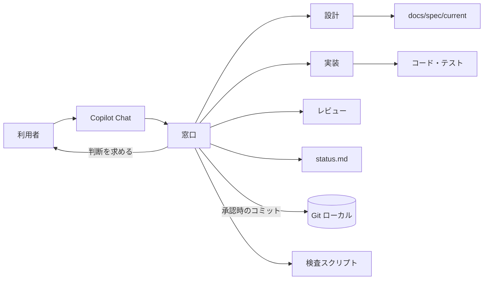

# スペック駆動開発支援の設計（ライト版）

## 位置付け

設計入力は [要件定義書](../requirements/README.md) とする。本フォルダは本仕組み自体の設計であり、支援先アプリの業務設計ではない。2026-10-20 にライト版へ見直した。見直し前の設計（ランナー中心の厳格版）は Git の履歴（コミット 96e81d6）で参照できる。

## 全体方針

| 設計 ID | 決定 |
| --- | --- |
| DES-COM-001 | 入口は VS Code の Copilot Chat とする。利用者は窓口のエージェント `sdd-orchestrator` に自然言語で依頼し、窓口が工程と担当を選ぶ。専用 UI は作らない。 |
| DES-COM-002 | 構成は、共通ルール 1、エージェント 4（窓口・設計・実装・レビュー）、スキル 14、検査スクリプト 1 とし、プラグイン `sdd` にまとめる（DES-TOOL-001）。リポジトリ版はプラグインから書き出しスクリプトで作り、別に手で保たない（DES-TOOL-007）。手順はスキルに置き、エージェントは役割と使えるツールと共通ルールへの参照だけを持つ。 |
| DES-COM-003 | 状態は案件ごとの Markdown 1枚（`status.md`）で管理し、承認は Git のローカルのコミットとして残す。版の照合・操作 ID・復旧情報などの独自の状態管理は持たない（DES-WF-004、DES-SPEC-003）。 |
| DES-COM-004 | 工程は規模で選ぶ。標準は「壁打ち → 要件 → 設計 → 実装 → 完了」で承認3回、軽量は「要点 → 実装 → 完了」で承認2回（DES-WF-001）。 |
| DES-COM-005 | 操作の安全は Copilot / VS Code の標準の確認（ターミナルの実行、ファイルの編集）に任せる。独自の hook・ガード・隔離実行は持たない。AI の Git 操作は状態の確認、確認後のローカルのブランチ作成、ローカルのコミットに限る（DES-TOOL-002）。 |
| DES-COM-006 | 導入と更新は、マーケットプレイスからのプラグインのインストールと更新で行い、導入先の workspace のファイルを変えない（DES-TOOL-005）。リポジトリで共有するときは、`npx github:` で書き出しスクリプトを実行し、導入先の `.github/` にリポジトリ版を書き出して人がコミットする。更新では手で変えたファイルを守る（DES-TOOL-007・008）。検査スクリプトは Node.js の標準機能だけで動き、依存のインストールを必要としない（DES-TOOL-003）。 |
| DES-COM-007 | AI の読み込みと出力は作業に必要な範囲に限る。指示に資料全体を最初に読む手順を置かない。委任と返却はパスと要点で行い、照合は `git diff --stat` で済ませる。既存の文書・コードの部分的な変更はエディターの差分の編集で行う。状況確認は `status.md` と検査スクリプトの要約だけを使う。 |

## 文書一覧

| 文書 | 対象 |
| --- | --- |
| [workflow-orchestration.md](workflow-orchestration.md) | 対話と工程、エージェント、スキル、承認とコミット、委任、中断と再開 |
| [specification-management.md](specification-management.md) | 原本と変更記録の配置、成果物の作成規約、`status.md`・`tasks.md` の書式、ADR |
| [tool-integration.md](tool-integration.md) | 環境と配置、Git の操作、検査スクリプト、安全、導入、リポジトリ版の書き出しと更新 |
| [development-verification.md](development-verification.md) | タスク、テスト先行の実装、確認の記録、レビューと完了、受入確認計画 |

## 要件との対応

| 要件 | 設計 |
| --- | --- |
| REQ-COM-001 | DES-COM-001、DES-WF-001。 |
| REQ-COM-002 | DES-WF-003（`sdd-clarification`）、DES-SPEC-003（質問の表）。 |
| REQ-COM-003 | DES-WF-004。 |
| REQ-COM-004 | DES-SPEC-002。 |
| REQ-COM-005 | DES-COM-006、DES-TOOL-005、DES-TOOL-007。 |
| REQ-COM-006 | DES-COM-002、DES-TOOL-001、DES-WF-002。 |
| REQ-COM-007 | DES-TOOL-006。 |
| REQ-COM-008 | DES-COM-006、DES-TOOL-007。 |
| REQ-COM-009 | DES-TOOL-007。 |
| REQ-COM-010 | DES-TOOL-008。 |
| NFR-COM-007 | DES-TOOL-007、DES-TOOL-008。 |
| NFR-COM-001 | DES-COM-002。手順はスキル、Copilot 固有の登録は agent の frontmatter と `plugin.json`。 |
| NFR-COM-002 | DES-SPEC-003、DES-TOOL-003。記録は要点だけとし、検査の出力は秘密らしい値を伏せる。 |
| NFR-COM-003 | 共通ルールに、資料の命令を承認・許可にしない規則を置く。 |
| NFR-COM-004 | DES-TOOL-002。コミットはパスを指定して行う。 |
| NFR-COM-005 | DES-COM-004、DES-COM-007。 |
| NFR-COM-006 | DES-COM-005、DES-TOOL-004。 |
